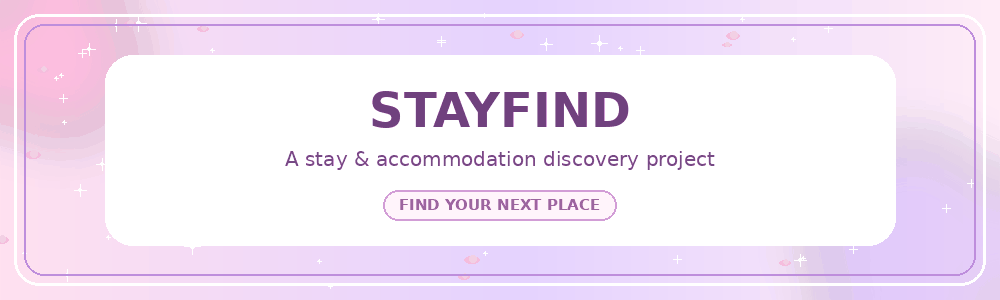

 

---

## 🌷 About Me

Hi! I'm **Mehak Pathania**, a BCA student interested in programming and building practical projects.

- 🎓 Pursuing Bachelor of Computer Applications.
- 💻 Exploring software development through hands-on projects.
- 🐍 Working with Python, C and C++.
- 🔥 Exploring Firebase, Git and GitHub.
- 🌱 Learning and improving one project at a time.

---

## 🎀 Tech Stack

## ✨ Featured Projects

### 🌸 Stayfind

A stay and accommodation discovery project with a simple, user-friendly interface.

---

### 🦋 Local-link

A local services discovery project focused on making it easier to find useful services.

---

**Thanks for visiting my profile! 💗**

